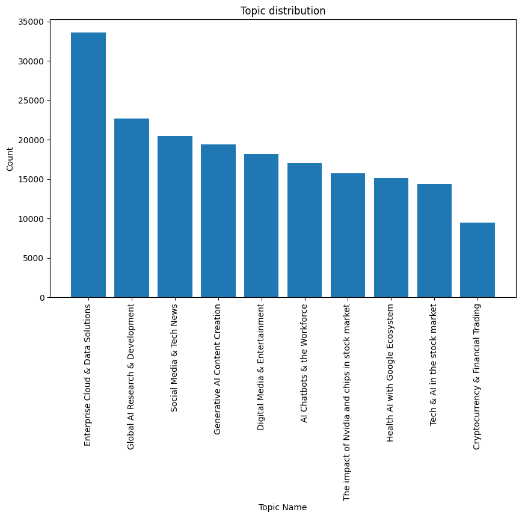
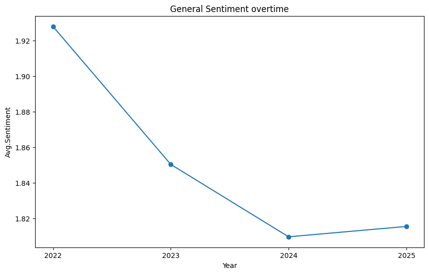
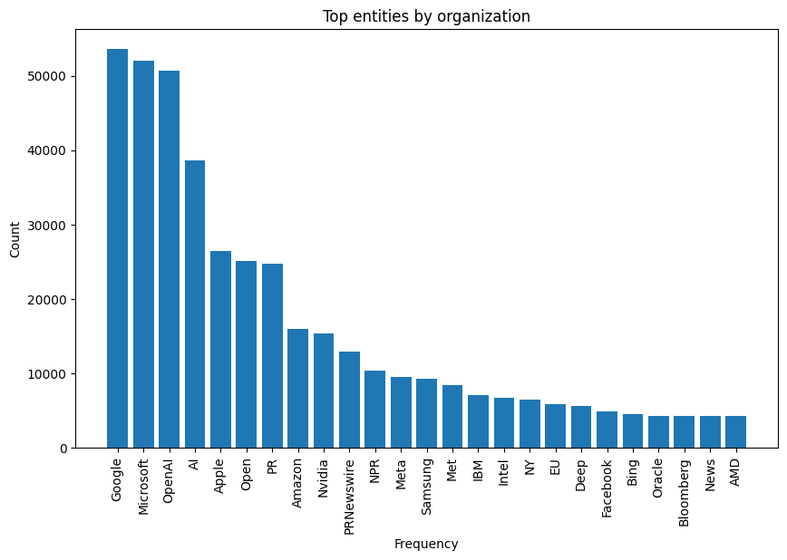
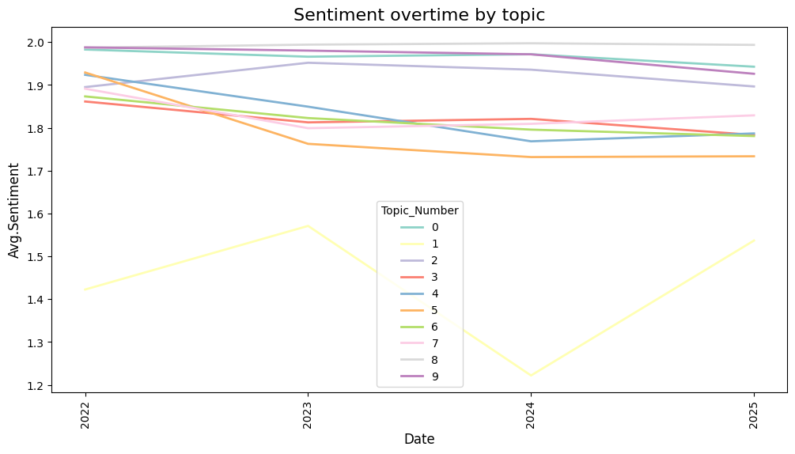
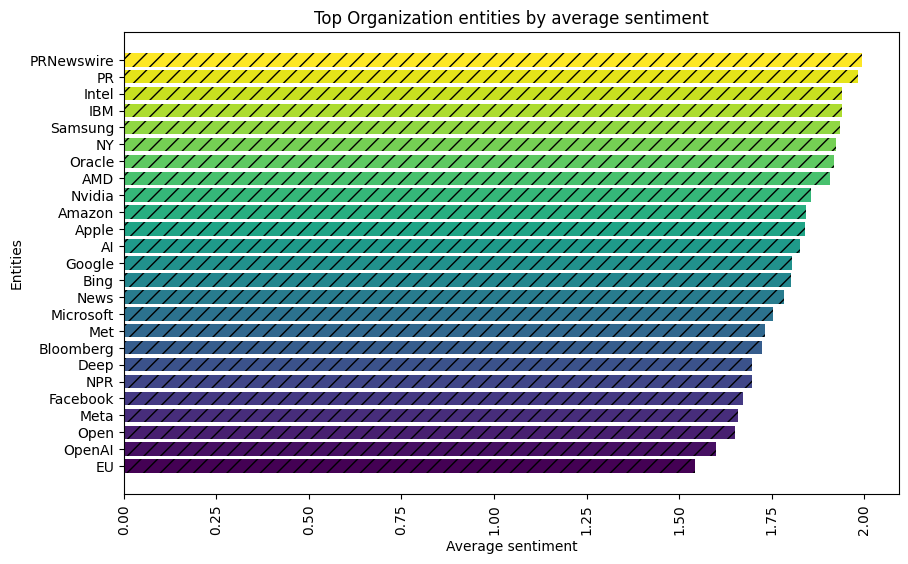
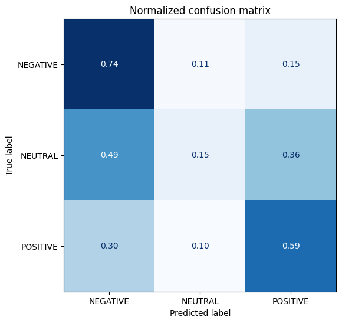

# Sentiment in AI across industries

**How does news coverage talk about AI, and how has its tone changed?** This project runs a full NLP pipeline over about 186,000 news articles on AI (2022 to early 2026): it cleans and filters the text, discovers topics with LDA, extracts the companies and technologies mentioned, and scores sentiment with a DistilBERT model that I fine-tuned myself. It then tracks tone by topic, company and technology over time.

The complete insights are in [`reports/AI_across_companies_and_industries.pdf`](reports/AI_across_companies_and_industries.pdf).

**Stack:** Python, pandas, spaCy, gensim (LDA), sentence-transformers, Hugging Face Transformers and Datasets, PyTorch, scikit-learn, matplotlib and seaborn.

## Repository structure

```
.
├── notebooks/            # 01 cleaning → 02 topics → 03 entities → 04 sentiment
├── reports/
│   ├── AI_across_companies_and_industries.pdf   # executive presentation
│   └── figures/          # charts used in this README
├── data/                 # intermediate files, see data/README.md
├── requirements.txt
└── LICENSE
```

## Pipeline

### Get and clean data 
[`01_data_cleaning`](notebooks/01_data_cleaning.ipynb)

•	Read the dataset of artificial intelligence using webscraping and applied initial EDA in the title and text columns. \
•	Clean title to drop source to avoid bias in the results. \
•	Clean text column removed in information before the title and after the main content article, to avoid considering menu options, publicity, content related to other articles, sources, and videos. \
•	Remove articles with fewer than 50 words, focus on video and image generation. \
•	Develop a references sentence for filter articles not related to impact of AI across industries using a transformer model called all-MiniLM-L6-v2 to compute cosine similarity, and filter documents using a threshold.
### Topic detection ##
[`02_topic_modeling`](notebooks/02_topic_modeling.ipynb)

•	A classic method, Latent Dirichlet Allocation (LDA), is select to discover the hidden topics in the articles. \
•	Apply a lemmatization process to a better comparison with lowercase tokens, removing stop words, and deleting punctuation. \
•	Create bigrams and trigrams to find more common concepts. \
•	Employ a grid search to establish the adequate number of topics, in this case was 10 topics. \
•	Name topics and analysis frequency across the corpus. \

### Entity extraction ##
[`03_entity_extraction`](notebooks/03_entity_extraction.ipynb)

•	Extract organizations and technologies of the text using a (NER) Bert-base-cased pretrain model of Hugging Face called ner-bert-base-cased-ontonotesv5-englishv4. This model was fine-tuning using different types of entities, such as organization, product, event, and person on several English datasets around weblogs, pr newsier, newsgroups, among others. \
•	Great visual plots of the main companies and technologies related to AI in the corpus.

### Sentimental analysis ##
[`04_sentiment_analysis`](notebooks/04_sentiment_analysis.ipynb)

•	In this case the approach is to train a model, rather than taking an algorithm already designed for this specific use case. \
•	A basic Bert model (distilbert-base-uncased) is use to be fine-tuned on a sentiment dataset. \
•	The dataset selected to execute the tunning process is community-datasets/per_sent, which captures the sentiment of a writer in a news article. It contains 5.3k documents with the possible labels (Positive, Neutral, Negative).

### Sentimental application ##
[`04_sentiment_analysis`](notebooks/04_sentiment_analysis.ipynb)

•	Apply the model to the clean corpus of AI across several industries and tools to understand the perception of people regarding this new technology. \
•	Run a sentiment analysis across the 10 topics identity in topic modeling section. \
•	Execute a sentiment analysis across entities focus on the top organizations and technologies. \
•	Check the average evolution over 2022 to 2026 for topic modeling, organizations, and technologies. \
If you want to make a deep dive into the main takeaways, feel free to explore the insights folder with the executive presentation and if you desire to explore the technical results enter the notebooks folder.


## Key findings

Sentiment is the model's score per article, averaged on a 0 (negative) to 2 (positive) scale. Read the results as relative differences in the tone of news coverage, not as public opinion (see [Limitations](#limitations-and-next-steps)).

**1. Coverage is dominated by enterprise and infrastructure stories.** Ten topics emerged (coherence 0.457). The largest is *Enterprise Cloud & Data Solutions* (18% of articles), followed by *Global AI Research & Development* (12%) and *Social Media & Tech News* (11%). *Cryptocurrency & Financial Trading* is the smallest (5%).



**2. Overall tone became less positive after 2022.** Average sentiment fell from about 1.93 in 2022 to about 1.81 in 2024 and stayed flat in 2025 (2026 is excluded because the data ends in February).




**3. The news articles regarding AI are very software tech focused**, companies such as Google, Microsoft, OpenAI, Meta, and Amazon represent the highest frequency, with 45% of articles being key players in this new revolution. In addition, semiconductor companies (Nvidia, AMD, Intel), database management (Oracle, IBM), manufacturers of electronics products (Apple, Samsung), and financial institutions (Bloomberg) appeared.



**4. AI Chatbos & Workforce stories are the most negative and enterprise cloud stories the most positive.** The time series trend sentiment by topic, it is clear that *“AI Chatbots & the Workforce (topic 0)”* has the most negative feeling compared to the others during the last 4 years, ranging from 1.2 to 1.4. Moreover, *”Generative AI Content Creation(topic 5)”* and *“Social Media & Tech News(topic 4)”* topics have been in constant decline since 2023. Finally, it is worth mentioning that *Enterprise cloud & Data solutions(topic 8)* have a very constant average positive of around 2.




**5. Companies developing frontier LLMs tend to have the worst perspective in contrast to hardware and enterprise vendors.** Intel, IBM, Samsung, Oracle and AMD score about 1.9 on average, while Meta (about 1.66) and OpenAI (about 1.6) are at the low end.




More charts (top companies and technologies, sentiment over time by company and technology) are in [`reports/figures/`](reports/figures).


## Sentiment model results

The model is trained on [`community-datasets/per_sent`](https://huggingface.co/datasets/community-datasets/per_sent) (3,355 training documents, labels negative, neutral, positive, the classes are imbalanced, with only about 10% negative). Training used a class-weighted cross-entropy loss and learning rate 2e-5.




On the test split, the model recovers 74% of negative and 59% of positive documents, but only 15% of neutral ones in the test sample. The model gets confused more often with non feeling articles, affecting the accuracy and F1 scores.

## Reproduce

**Google Colab (how it was developed):** open a notebook with the badge at the top of each one, upload your raw data to the Drive folder named in the first code cell, and run the notebooks in order. A GPU runtime is recommended for notebooks 03 and 04.

**Locally:**

```bash
git clone https://github.com/mgalvis60/sentiment_in_AI_across_industries.git
cd sentiment_in_AI_across_industries
python -m venv .venv && source .venv/bin/activate
pip install -r requirements.txt
python -m spacy download en_core_web_sm
playwright install chromium          # only for the pyLDAvis PNG export in notebook 02
cd notebooks && jupyter lab          # run 01 -> 04 in order
```

* **Data:** the raw scraped articles are not included. [`data/README.md`](data/README.md) describes the expected file and columns and lists every intermediate file.
* **Paths:** each notebook sets `DATA_DIR` in its first code cell (a Drive folder in Colab, `data/` locally), so there are no hardcoded paths to edit.
* **Caching:** the slow steps (lemmatization, coherence search, NER inference) run only when their cached file is missing, so re-running is fast.

